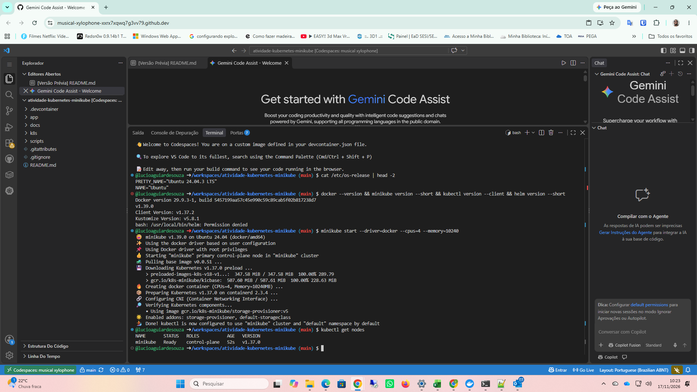
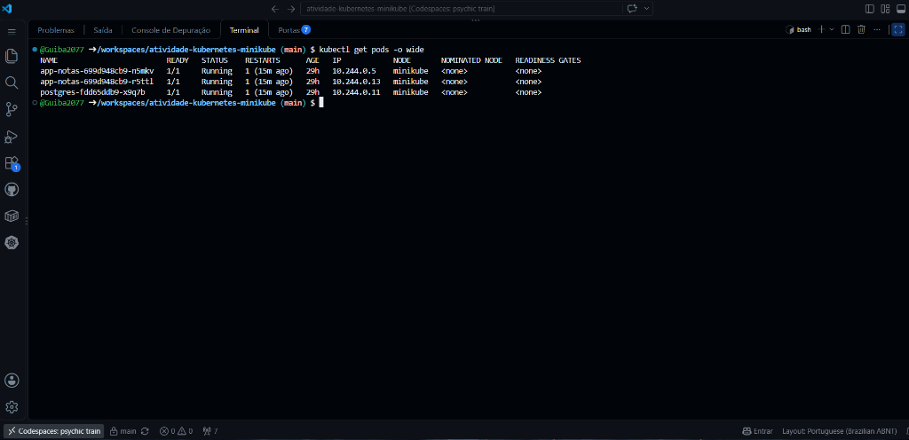
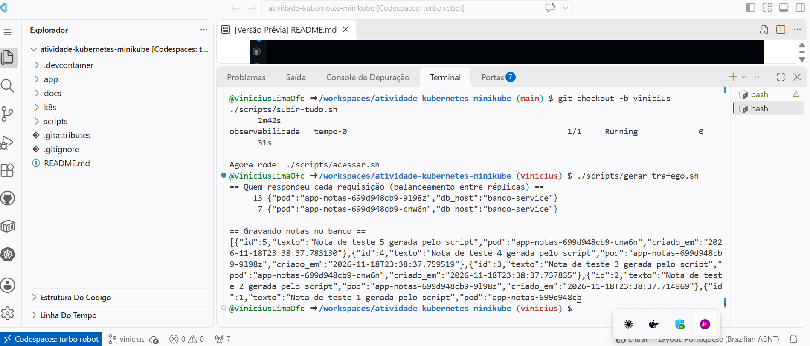
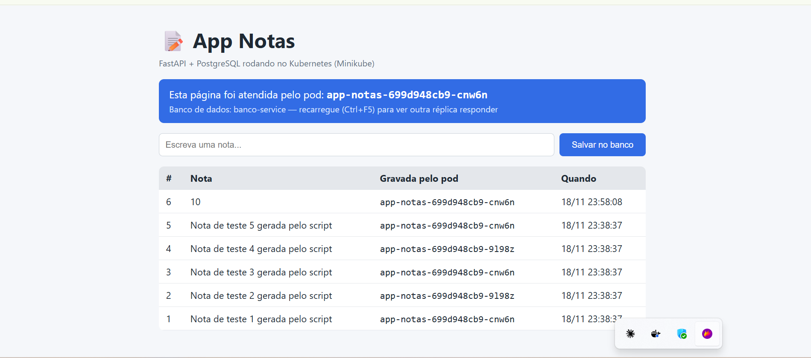
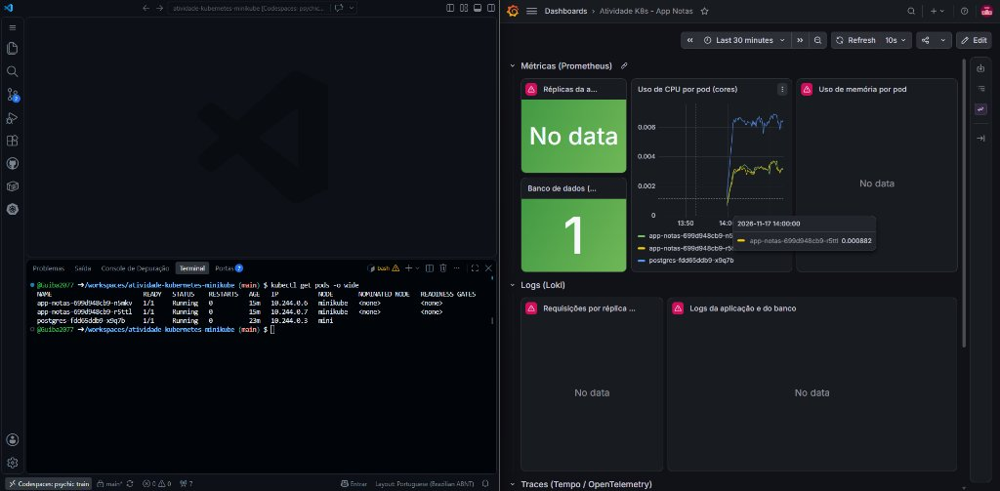
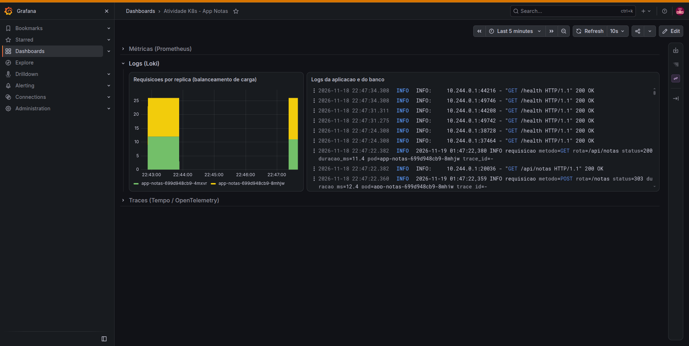
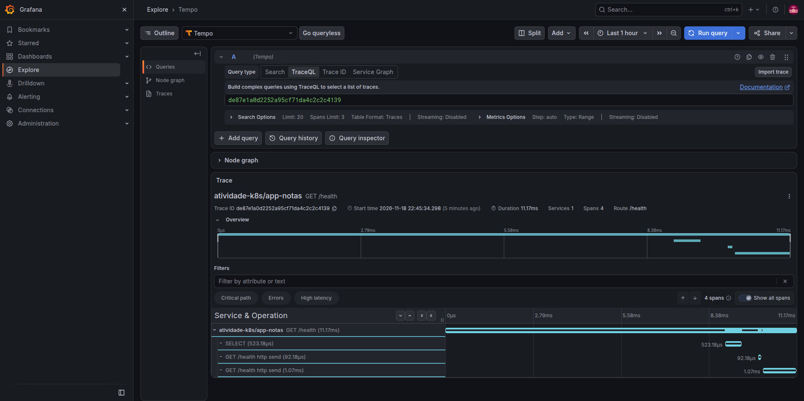

# Atividade Kubernetes — App Notas no Minikube com Observabilidade (Prometheus, Loki, Tempo, OpenTelemetry e Grafana)

## 1. Sobre a aplicação

**App Notas** é uma aplicação web simples escrita em **Python (FastAPI)** que grava e lista notas num banco **PostgreSQL**.

- Roda com **2 réplicas** no Kubernetes, atrás de um Service do tipo **NodePort**, que faz o balanceamento de carga.
- Cada página mostra **qual pod atendeu a requisição**, e cada nota registra o pod que a gravou. Assim dá para ver o balanceamento na própria tela.
- É instrumentada com **OpenTelemetry** (instrumentação automática), que gera **traces** de cada requisição HTTP e de cada query SQL.

## 2. Arquitetura

```
                  ┌──────────────── Cluster Minikube ──────────────────────────────┐
 Navegador ──▶ app-service (NodePort 30080)                                        │
                  │        ├──▶ pod app-notas #1 ─┐                                 │
                  │        └──▶ pod app-notas #2 ─┴──▶ banco-service ──▶ postgres   │
                  │                    │ traces (OTLP)                              │
                  │                    ▼                                            │
                  │   OTel Collector (DaemonSet) ──traces──▶ Tempo                  │
                  │      └─ lê logs de /var/log/pods ──logs──▶ Loki                 │
                  │   Prometheus ◀── métricas (kube-state-metrics, cAdvisor)        │
                  │   Grafana ◀── Prometheus + Loki + Tempo                         │
                  └─────────────────────────────────────────────────────────────────┘
```

| Componente | Função | Como foi instalado |
|---|---|---|
| PostgreSQL 16 | Banco de dados | Manifestos em `k8s/banco/` |
| App Notas (2 réplicas) | Aplicação web | Manifestos em `k8s/app/` |
| Prometheus | Métricas do cluster e dos pods | Helm `kube-prometheus-stack` |
| Grafana | Dashboards | Helm `kube-prometheus-stack` |
| Loki | Logs centralizados | Helm `grafana-community/loki` (Monolithic) |
| Tempo | Traces distribuídos | Helm `grafana-community/tempo` |
| OpenTelemetry Collector | Recebe traces e coleta logs | Helm `open-telemetry/opentelemetry-collector` |

## 3. Estrutura do repositório

```
.devcontainer/          Ambiente do GitHub Codespaces (Docker, Minikube, kubectl, Helm)
app/                    Código da aplicação + Dockerfile
k8s/
  banco/                Secret, PVC, Deployment e Service (ClusterIP) do PostgreSQL
  app/                  Deployment (replicas: 2) e Service (NodePort) da aplicação
  observabilidade/      values.yaml dos charts Helm + dashboard do Grafana
scripts/                subir-tudo.sh, acessar.sh, gerar-trafego.sh
docs/evidencias/        Capturas de tela
```

## 4. Como executar (passo a passo)

> O ambiente roda no **GitHub Codespaces**: basta um navegador. No repositório, clique em **Code → Codespaces → Create codespace on main**. O `.devcontainer` já instala Docker, Minikube, kubectl e Helm numa máquina de 4 núcleos e 16 GB.

### Etapa 1 — Iniciar o Minikube
```bash
minikube start --driver=docker --cpus=4 --memory=10240
kubectl get nodes
```

### Etapa 2 — Banco de dados
```bash
kubectl apply -f k8s/banco/banco-secret.yaml
kubectl apply -f k8s/banco/banco-pvc.yaml
kubectl apply -f k8s/banco/banco-deployment.yaml
kubectl apply -f k8s/banco/banco-service.yaml
kubectl get pods
```

### Etapa 3 — Aplicação replicada
```bash
minikube image build -t app-notas:1.0 ./app     # constrói a imagem dentro do Minikube
kubectl apply -f k8s/app/app-deployment.yaml
kubectl apply -f k8s/app/app-service.yaml
kubectl get pods -o wide
```

### Etapa 4 — Stack de observabilidade (Helm)
```bash
helm repo add prometheus-community https://prometheus-community.github.io/helm-charts
helm repo add grafana-community https://grafana-community.github.io/helm-charts
helm repo add open-telemetry https://open-telemetry.github.io/opentelemetry-helm-charts
helm repo update
kubectl create namespace observabilidade

helm install kps prometheus-community/kube-prometheus-stack -n observabilidade -f k8s/observabilidade/kube-prometheus-stack-values.yaml
helm install loki grafana-community/loki -n observabilidade -f k8s/observabilidade/loki-values.yaml
helm install tempo grafana-community/tempo -n observabilidade -f k8s/observabilidade/tempo-values.yaml
helm install otel-collector open-telemetry/opentelemetry-collector -n observabilidade -f k8s/observabilidade/otel-collector-values.yaml
kubectl apply -f k8s/observabilidade/grafana-dashboard-configmap.yaml

kubectl get pods -n observabilidade
```

### Etapa 5 — Validação
```bash
minikube service app-service --url    # URL da aplicação
./scripts/gerar-trafego.sh            # mostra o balanceamento e grava notas no banco
./scripts/acessar.sh                  # libera a App (8080) e o Grafana (3000) no navegador
```
- **App:** aba **PORTS** do Codespaces → porta 8080.
- **Grafana:** porta 3000 (usuário `admin`, senha `admin123`) → Dashboards → **Atividade K8s - App Notas**.

> Atalho: `./scripts/subir-tudo.sh` executa as etapas 1 a 4 de uma vez.

## 5. Evidências

### Etapa 1: Minikube iniciado e nó `Ready`


### `kubectl get pods`: 2 réplicas da app e o banco rodando


### Balanceamento de carga entre as réplicas


### Aplicação funcionando no navegador


### Grafana: métricas do Prometheus


### Grafana: logs do Loki


### Grafana: traces do Tempo


## 6. Integrantes
- Lúcio Aguiar de Souza
- Guilherme Silva Costa
- Vinicius Pereira De Lima
- Ramon Silva
